# Architecture assessment: Rule-Conditioned Graduated Moderation

Final (closed after round 2). Source: `docs/117002029_NLP_PropuestaProyecto.pdf` (proposal of 2026-10-18).

This document records the architecture and technology decisions, and the low-level algorithms behind them. Workstreams and tasks are decomposed **after** this review closes.

## Changes in round 2

Status: **final**. No open questions.

| Feedback | What I did |
|---|---|
| Answer `gpu-sharing`: never concurrent | D27; section 3.1 now states the profiles take turns |
| Answer `contract-boundaries`: five boundaries + invariant suite | D28; section 3.2 states the decision |
| Answer `stage2-agreement`: reading A | D29; section 5.1 diagram and text updated |
| Answer `encoder-switch-rule`: switch only on a clear CV win within the cap | D30; section 6.3 |
| Answer `engine-v1-escalation`: no escalation from V1 | D31; section 6.4 |
| Answer `engine-precedence`: discretion flag wins | D32; section 6.4 |

---

## 1. Decisions

| # | Decision |
|---|---|
| D1 | Stack **B, trimmed** (section 3) |
| D2 | Kick-off and development on the Raspberry Pi 5; the RTX 5060 Ti box is used over SSH or with its own Claude session. Responsibilities are not split by machine. |
| D3 | **Docker on the GPU box** (draft in 3.1, configured by you) |
| D4 | Config: `params.yaml` + `dvc exp run --queue --set-param` |
| D5 | Tracking: DVCLive |
| D6 | Local judge: vLLM with structured outputs and prefix caching |
| D7 | Verdict and severity decoded jointly over valid (v, s) pairs |
| D8 | Policy engine monotonicity tested with Hypothesis property tests |
| D9 | Classifier calibration: temperature scaling on out-of-fold predictions; ECE via `torchmetrics` |
| D10 | Keyword matcher: `pyahocorasick` with Spanish normalization and an offset map |
| D11 | **Evaluation: fixed held-out test + 5-fold grouped CV inside training** |
| D12 | Secondary splits: leave-one-platform-out, leave-cluster-out, cross-language transfer (EN train, ES test) |
| D13 | Translation duplicates: embeddings + exact kNN |
| D14 | Embedder for translation duplicates and rule candidates: LaBSE |
| D15 | Rule DSU edges: embedding candidates + mutual entailment + manual queue |
| D16 | Context: K = 1 explicit parent; preceding window K ≤ 3 as ablation |
| D17 | Judge throughput: prefix caching with pairs sorted by ruleset; shuffled options after the ruleset; Stage-2 calls ordered by ruleset |
| D18 | Ordinal loss: own cumulative-link implementation |
| D19 | Language ID: lingua-py, restricted set + confidence threshold |
| D20 | Dialect slice: TwitterAAE + multi-VALUE counterfactuals |
| D21 | Identity slice: hand-written minimal pairs + Multilingual HateCheck (ES) + HateCheck (EN), filtered per ruleset |
| D22 | Slice metrics: Fairlearn `MetricFrame` + own cluster bootstrap |
| D23 | Annotation: Label Studio for message labels; Gradio for review queues and duration judgments |
| D24 | Call cache with hard $20 budget stop (5.2) |
| D25 | Dynamic padding and length-grouped batches for the encoder |
| D26 | Encoder comparison: XLM-R base (main) vs mDeBERTa-v3-base, mDeBERTa-v3-base-XNLI, mmBERT-base, XLM-R large (upper reference) |
| D27 | vLLM judge and training never share the GPU: compose profiles `judge` and `train` take turns |
| D28 | Data contracts: five pandera boundaries (rules, canonical clusters, messages, pairs with folds, labels) + split invariant suite as a blocking DVC stage |
| D29 | Stage-2 agreement: the two Stage-2 judges must agree on the verdict; on disagreement the Stage-1 verdict breaks the tie if it matches one of them, otherwise the pair is unresolved |
| D30 | Encoder switch: a challenger replaces XLM-R base only if it wins on CV QWK with a paired CI excluding zero and is within the 300M cap; recorded as a deviation |
| D31 | Policy engine acts only on V2 and V3; history never escalates V1 |
| D32 | Discretion flag takes precedence over a sanction hint: route to human review |

### Deviations from the proposal (to carry into the final report)

- **Message context.** Proposal 1.2 says the classifier judges the message alone. D16 adds the explicit parent; the verdict still concerns the target message only.
- **Translation duplicates.** Proposal 4.6 uses MinHash/LSH; cross-language duplicates need embeddings (D13).
- **Validation.** The proposal has train and held-out rulesets only; D11 adds grouped CV inside training.
- **Option shuffling.** Options are shuffled per pair but placed after the ruleset (D17).
- **Encoder.** If a challenger replaces XLM-R base under D30, that is a deviation too.

---

## 2. System overview

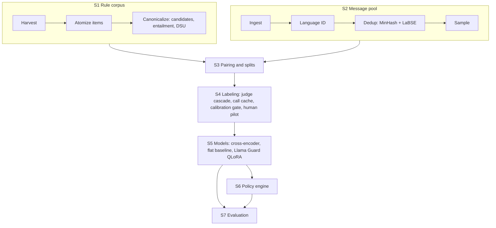

**Compute.** Any stage can run on either machine. The Pi runs the CPU test suite and anything light. Stages that need a GPU (vLLM judge, LaBSE over the full pool, encoder training, QLoRA) run on the 5060 Ti box. The dependency set must therefore resolve on both aarch64 (CPU torch) and x86_64 (CUDA 12.8 torch); section 3.1 shows how.

---

## 3. Stack B, trimmed

| Layer | Choice |
|---|---|
| Environment | uv with lockfile and per-platform torch sources; Docker on the GPU box |
| Storage | Parquet + DuckDB/Polars |
| Contracts | pydantic for records; pandera at stage boundaries (3.2) |
| Pipeline | DVC stages |
| Config | `params.yaml` + `dvc exp` |
| Data remote | DVC remote over SSH, plus a local disk copy |
| Local judge | vLLM, in its own container |
| API judges | `openai` SDK + batch APIs, behind the call cache |
| Training | HF Trainer/Accelerate, PEFT + TRL; Unsloth as fallback |
| Tracking | DVCLive |
| Annotation | Label Studio + Gradio |
| Report | Quarto, set up in week 4 |

### 3.1 Docker on the GPU box (draft for you to configure)

Two containers:

- **`judge`** is the official vLLM image. vLLM pins an exact torch build. Keeping it out of the project environment means the training stack's torch never has to match it. The project talks to it over the OpenAI-compatible HTTP API.
- **`work`** is the project image: CUDA 12.8 runtime, uv, the locked environment, with the repository bind-mounted.

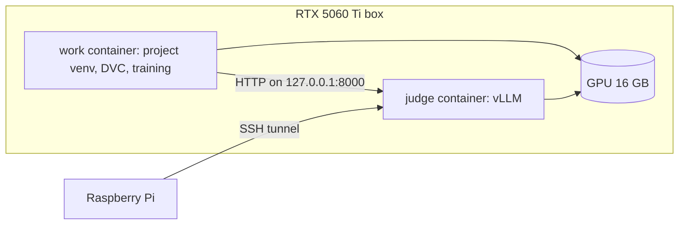

`Dockerfile` (draft; every `<pin>` is an exact tag you check before building):

```dockerfile
FROM nvidia/cuda:<pin: 12.8.x-cudnn-runtime-ubuntu24.04>
RUN apt-get update && apt-get install -y --no-install-recommends git ca-certificates \
    && rm -rf /var/lib/apt/lists/*
COPY --from=ghcr.io/astral-sh/uv:<pin> /uv /uvx /bin/
ENV UV_LINK_MODE=copy \
    UV_PROJECT_ENVIRONMENT=/opt/venv \
    PATH=/opt/venv/bin:$PATH
WORKDIR /workspace
COPY pyproject.toml uv.lock ./
RUN uv sync --locked --no-install-project --extra gpu
# the repository itself is bind-mounted at /workspace by compose
```

The venv lives in `/opt/venv`, so the bind mount of the repository does not hide it.

`compose.yaml` (draft):

```yaml
services:
  judge:
    image: vllm/vllm-openai:<pin>
    profiles: ["judge"]
    command: >
      --model Qwen/Qwen2.5-7B-Instruct-AWQ
      --max-model-len 8192
      --gpu-memory-utilization 0.85
      --enable-prefix-caching
      --api-key ${VLLM_API_KEY}
    ports: ["127.0.0.1:8000:8000"]
    volumes: ["${HF_HOME:-~/.cache/huggingface}:/root/.cache/huggingface"]
    deploy:
      resources:
        reservations:
          devices: [{driver: nvidia, count: all, capabilities: [gpu]}]
  work:
    build: .
    profiles: ["train"]
    volumes:
      - .:/workspace
      - ${HF_HOME:-~/.cache/huggingface}:/root/.cache/huggingface
    environment: [JUDGE_URL=http://judge:8000/v1]
    deploy:
      resources:
        reservations:
          devices: [{driver: nvidia, count: all, capabilities: [gpu]}]
```

- The vLLM port is bound to `127.0.0.1` only, with an API key. The Pi reaches it through `ssh -L 8000:127.0.0.1:8000`. vLLM has no other access control, so it must never listen on `0.0.0.0`.
- Profiles let you start `judge` and `train` separately; they take turns (D27).

`pyproject.toml`, so the same lockfile works on the Pi and in the container:

```toml
[project.optional-dependencies]
gpu = ["bitsandbytes", "peft", "trl"]

[tool.uv.sources]
torch = [
  { index = "pytorch-cu128", marker = "platform_machine == 'x86_64'" },
  { index = "pytorch-cpu",   marker = "platform_machine == 'aarch64'" },
]

[[tool.uv.index]]
name = "pytorch-cu128"
url = "https://download.pytorch.org/whl/cu128"
explicit = true

[[tool.uv.index]]
name = "pytorch-cpu"
url = "https://download.pytorch.org/whl/cpu"
explicit = true
```

**GPU sharing.** With `--gpu-memory-utilization 0.85`, vLLM reserves about 13.6 GB up front. Any training run started next to it will run out of memory.

| Option | For | Against |
|---|---|---|
| **Never concurrent: `judge` and `train` profiles take turns (recommended)** | Simple, no surprise OOMs | The labeling and training phases are sequential anyway (labels before training), so little is lost |
| Shared: vLLM at about 0.5 (8 GB), training in the other 8 GB | XLM-R base training can overlap with labeling | Smaller KV cache slows the judge; XLM-R large and QLoRA do not fit |
| Rent a GPU for training while the box labels | Parallel phases | Cost and a second environment |

**Decision (D27):** never concurrent. The `judge` and `train` profiles take turns: labeling runs first, then training.

### 3.2 Data contracts: what the trim loses

Trimmed: pydantic for records (judge outputs, rule records, config), pandera only where data changes hands between stages.

| What pandera everywhere would catch | Lost with the trim? | Why it matters |
|---|---|---|
| Wrong dtype or nulls inside a multi-step stage | Partly: caught at the next boundary instead of where it happened | Debugging is slower, but nothing bad reaches training |
| Intermediate artifacts (embeddings, kNN candidate edges, DSU tables) | Yes, unless one is a boundary | A wrong DSU table silently corrupts the canonical clusters and every split built on them |
| **Split leakage**: a message, or a member of its duplicate group, on both sides of a split; a test ruleset with no new cluster | **pandera does not catch this at all.** These are cross-table properties, and a pandera schema validates one frame | This is the central claim's validity |
| Verdict–severity constraint on labels | No, the label boundary covers it | |
| Distribution drift (e.g. V0 share per ruleset) | Yes; pandera can check statistics | Useful but not critical; a report covers it |

So the trim loses little in itself. The real gap, leakage, exists in either version. Proposal:

1. **Five boundaries** instead of four: rules, **canonical clusters**, messages (with duplicate group id), pairs with fold assignment, labels.
2. A **split invariant suite**: pytest tests run as a DVC stage after fold assignment. The pipeline stops if any fails.
   - No duplicate group appears in more than one partition.
   - No test message appears in any training pair, under any ruleset.
   - Every test ruleset has at least one cluster absent from training.
   - Every cross-pair's message comes from its ruleset's partition.
   - Fold sizes and the language and platform mix are within tolerance.

**Decision (D28):** five pandera boundaries plus the split invariant suite.

---

## 4. Data, splits and labels

### 4.1 Evaluation design and fold assignment (D11)

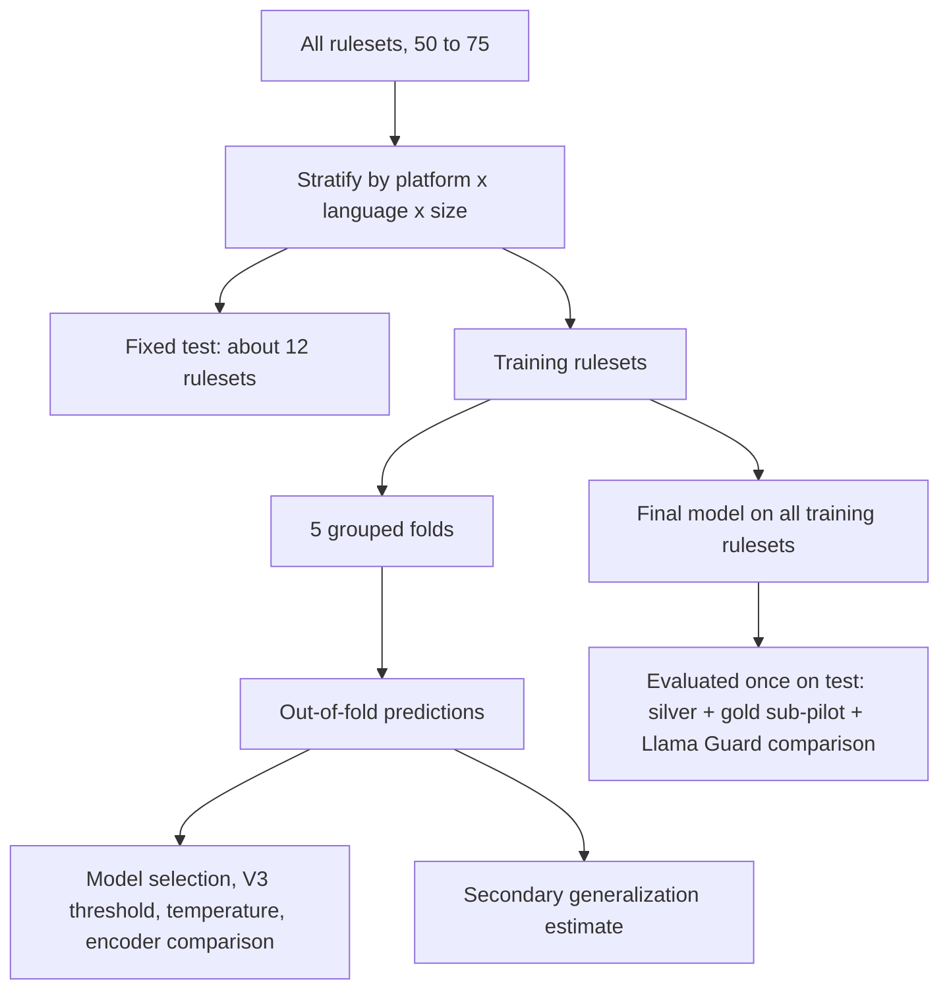

Fold assignment, step by step:

1. **Duplicate groups first.** Every message has a `dup_group_id` from 4.2. The group is the unit that moves; a group is never split.
2. **Rulesets to partitions.** Greedy balancing assigns rulesets to `test` or `fold_1..5`, stratified by platform, language and message count. The platform-norm rulesets (Wikipedia talk, Twitter/X policy) are large and are placed first, so the rest can balance around them.
3. **New-cluster repair.** For each test ruleset, check that at least one of its canonical clusters is absent from all training rulesets. If not, swap it with a training ruleset of the same stratum and re-check, up to a fixed number of tries, then report it.
4. **Messages to partitions.** Natively paired messages follow their native ruleset. The remaining pool of each language is split into partitions in proportion to the number of rulesets, by duplicate group.
5. **Cross-pairs** for ruleset *r* sample messages only from the partition of *r*.
6. The **invariant suite** (3.2) runs; the pipeline stops on any failure.
7. The assignment, seed and manifest are written and tracked by DVC.

The secondary splits (leave-one-platform-out, leave-cluster-out, EN→ES) reuse steps 4 to 6 with a different partition rule.

### 4.2 Message deduplication (D13, D14)

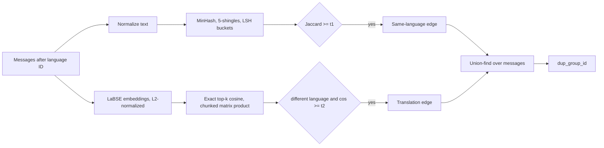

- **t1** (around 0.8) is a standard near-duplicate threshold.
- **t2** is calibrated on about 200 labelled candidate pairs: the highest-scoring cross-language pairs plus a band around the decision point.
- Translation edges are cross-language only. Same-language pairs with high cosine are often paraphrases ("you're an idiot" / "you are a moron"), not duplicates, so they stay with MinHash.
- Cost: 50K × 768 float32 is about 150 MB. The all-pairs product is 2.5 × 10⁹ dot products in chunks of 4K rows: seconds on the GPU, minutes on the Pi.

### 4.3 Rule canonicalization (D15)

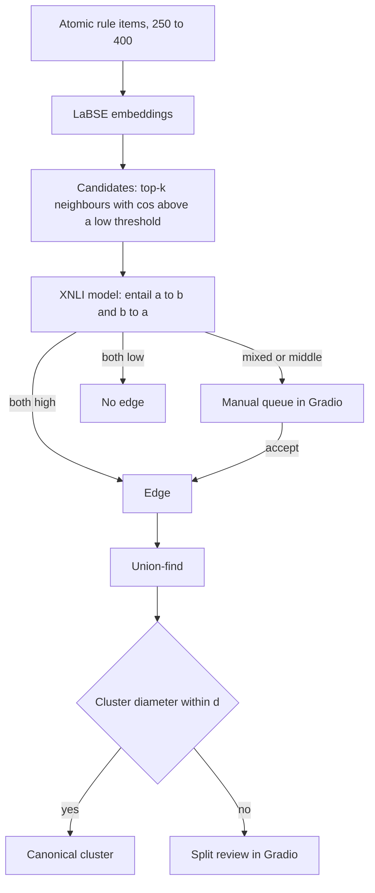

- The entailment model sees the full item text: rule, scope and exceptions. "No insults" and "No insults toward streamers" entail one way only, so they go to the queue, which is the right outcome.
- The **diameter check** catches chaining: the largest pairwise cosine distance inside a cluster above *d* sends it to review.
- The DSU is incremental, so the **saturation curve** (new clusters per additional 10 rulesets) comes for free as rulesets are added.

### 4.4 Statistical power (recorded risk)

Fifteen rulesets × 300 pairs = 4,500 pairs. Assuming an intra-ruleset correlation of 0.05, the design effect is about 16, so those pairs behave like about 280 independent ones. Mitigations, in order:

1. Paired comparisons.
2. A power simulation on the week-2 minimal pipeline.
3. The out-of-fold estimate over training rulesets as secondary evidence.
4. If the target is out of reach, declare it as a limitation in advance.

### 4.5 Message context and input layout (D16)

```
segment A (truncatable)                                     segment B (kept whole)
[ "Context: " parent tail, at most 128 tokens ][ "Message: " target ]  </s></s>  [ rule item: text, scope, exceptions ]
```

- Plain-text markers ("Context:", "Message:"), not new special tokens. New tokens would start with untrained embeddings, which is risky at this data size.
- Truncation order: the parent is cut from its start down to 128 tokens; if the pair is still over 512, the message is cut from its end. The rule item is never cut.
- Aho-Corasick highlight markers, when on, are inserted inside the message segment (4.11).
- **Context dropout** of about 0.3 in training: the context segment is removed.
- A `context_source` field (`reply_link` or `none`) on every message, and an evaluation slice with/without parent.
- The judge receives the same parent text with the same truncation.

---

## 5. Labeling

### 5.1 Judge cascade

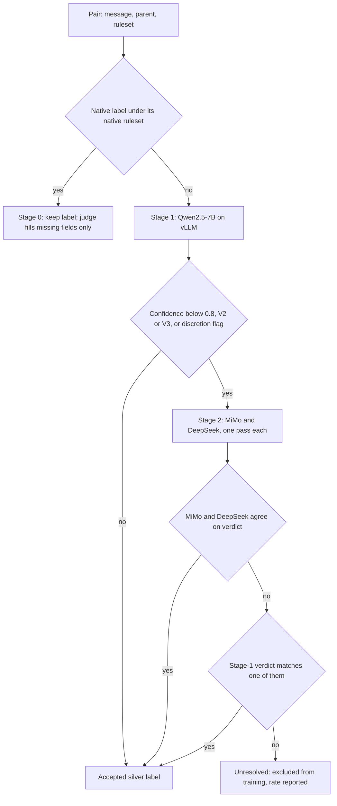

Drawing this exposed an ambiguity in proposal Table 7. "Agreement is accepted. Disagreement goes to one decisive third pass" does not say **who must agree**, or **who runs the third pass**.

| Reading | Agreement means | Third pass |
|---|---|---|
| **A (recommended)** | The two Stage-2 judges agree on verdict | Stage-1 verdict breaks the tie if it matches one of them; otherwise unresolved |
| B | At least two of three (Stage 1 + both Stage-2) agree | None needed, majority decides |
| C | The two Stage-2 judges agree | A second sampled pass of one Stage-2 judge |

A keeps the decision with the stronger API judges and costs nothing extra. B gives Stage 1, which also produces the rule-prompted baseline, a vote on its own hard cases. C doubles cost on disagreements.

**Decision (D29):** reading A. The two Stage-2 judges must agree on the verdict. On disagreement, the Stage-1 verdict breaks the tie if it matches one of them; otherwise the pair is unresolved. No extra API cost.

### 5.2 Call cache and budget stop (D24)

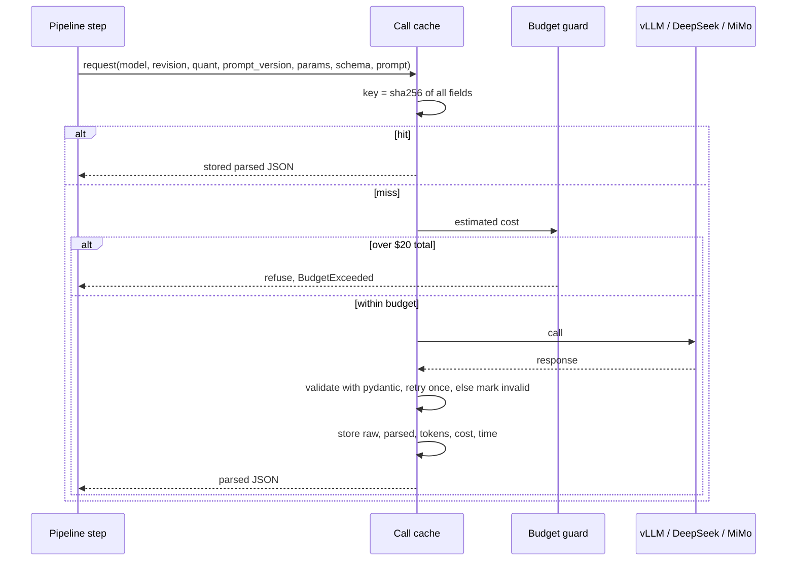

It is used by Stage 1, the calibration-gate reruns, Stage 2, the rule-prompted baseline, the held-out sub-pilot comparison, and the 6.4 audit record.

### 5.3 Judge prompt layout (D17)

```
┌ system: rubric, prompt_version              ┐
│ few-shot: 3 examples per verdict class      │  shared prefix, cached once per ruleset
└ ruleset: items with ids, scope, exceptions  ┘
┌ verdict options, shuffled per pair          ┐
│ context: parent (same truncation as 4.5)    │  per-pair tail, recomputed
└ message: target                             ┘
→ structured JSON: rule_ids[], verdict, severity, confidence, discretion_used
```

- Pairs are sorted by ruleset, so the prefix is computed once per ruleset.
- The shuffle seed is derived from `pair_id` and stored, so every prompt can be rebuilt exactly.
- The output schema allows only valid (verdict, severity) combinations (6.2).

---

## 6. Models

### 6.1 Rule-conditioned cross-encoder forward pass

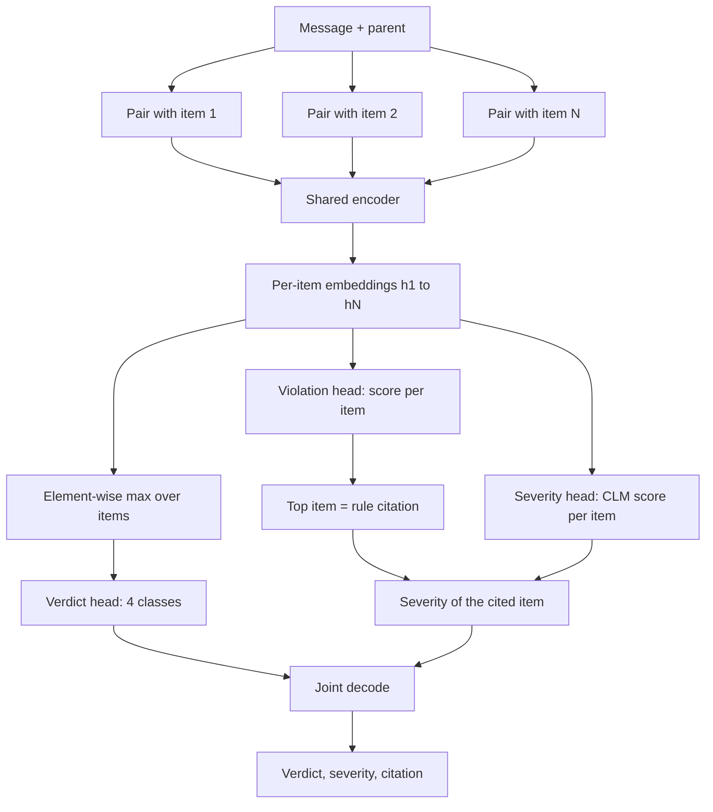

- All N items of a message are in the same batch, because the max pooling needs them together.
- Training loss: L = λ₁ · BCE(violation per item) + λ₂ · CLM(severity per item) + λ₃ · CE(verdict). The λ values are set on the CV folds.

### 6.2 Ordinal loss and joint decode (D7, D18)

Cumulative-link model for the severity of one item, with score f and ordered cutpoints θ₀ < θ₁ < θ₂:

```
θ = cumsum([b, softplus(d1), softplus(d2)])        # ordering guaranteed
P(s ≤ k) = σ(θ_k − f)          for k = 0, 1, 2
P(s = 0) = P(s ≤ 0)
P(s = k) = P(s ≤ k) − P(s ≤ k−1)   for k = 1, 2
P(s = 3) = 1 − P(s ≤ 2)
loss = −log P(s = y)
```

Joint decode over the valid grid only:

| Verdict | Valid severities |
|---|---|
| V0 | 0 |
| V1 | 1, 2 |
| V2 | 1, 2, 3 |
| V3 | 1, 2, 3 |

(v̂, ŝ) = argmax over valid pairs of log P(v) + log P(s | cited item). The share of raw predictions that fall outside the grid is logged as a diagnostic.

### 6.3 Encoder comparison (D26)

Five models: XLM-R base (main), mDeBERTa-v3-base, mDeBERTa-v3-base-XNLI, mmBERT-base, and XLM-R large as an upper reference.

- **Week 2, on the minimal pipeline:** one seed each, grouped CV folds, primary score QWK on out-of-fold predictions. With only 12 training rulesets the folds are tiny, so this round is a filter, not a verdict.
- **Week 3, on the full training set:** XLM-R base plus the best challenger get 3 seeds each in CV.
- XLM-R large (560M) fits in 16 GB with bf16, gradient checkpointing and a small batch, but it is outside the proposal's 100–300M range.
- mmBERT needs a recent `transformers` (ModernBERT architecture); check this in the Docker image.

**Decision (D30):** a challenger replaces XLM-R base only if it wins on CV QWK with a paired CI excluding zero and is within the 300M cap. A switch is recorded as a deviation. XLM-R large stays a reference only.

### 6.4 Policy engine

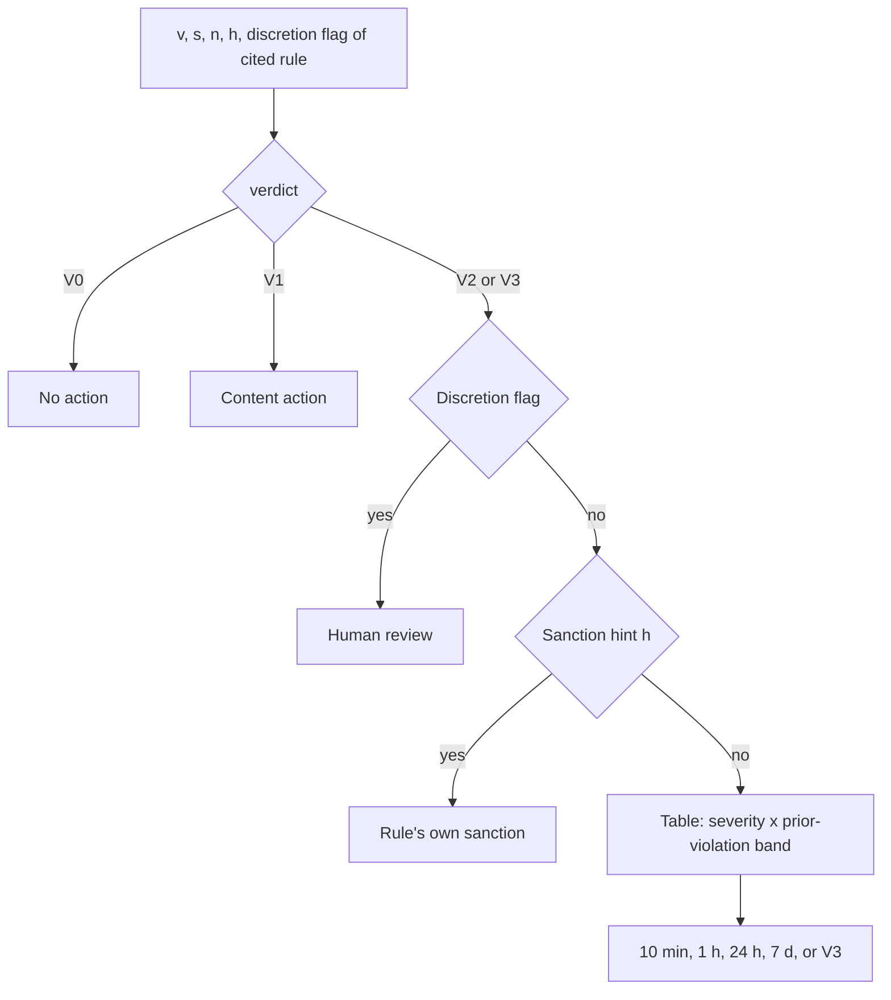

Drawing it raised two questions the proposal does not settle:

1. **Does history escalate V1?** The engine's output set (V2 bucket, V3, human review) suggests it only acts on V2 and V3. Many real communities escalate repeated content violations to a timeout ("three strikes"). Escalation makes the engine more realistic, but a V1 label then drives a sanction the classifier never predicted.
2. **Precedence.** When a cited rule has both a discretion flag and a sanction hint, which wins? Discretion first is the safer choice: it never forces a sanction a moderator was meant to weigh. Hint first respects rules that state "immediate ban" explicitly.

Monotonicity properties for Hypothesis, on rules without the discretion flag:

```
order: 10 min < 1 h < 24 h < 7 d < V3
g(v, s + 1, n, h) ≥ g(v, s, n, h)
g(v, s, n + 1, h) ≥ g(v, s, n, h)
g(V3, s, n, h)   ≥ g(V2, s, n, h)
```

Human review sits outside the order. A separate test checks that the discretion flag always yields human review.

**Decision (D31):** the engine acts only on V2 and V3; history never escalates V1.

**Decision (D32):** the discretion flag wins and routes to human review, even when the rule states its own sanction. Section 6.4 diagram already reflects this order.

---

## 7. Pipeline components

### 7.1 Language identification (D19)

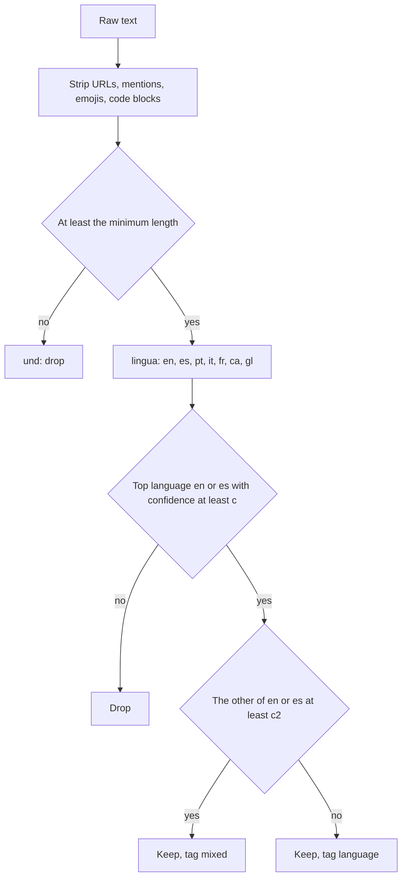

The minimum length, c and c2 are set on a hand-checked sample of about 300 Discord lines.

### 7.2 Keyword matcher (D10)

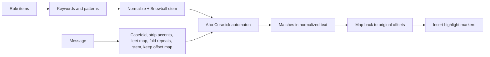

The **offset map** is the low-level detail that matters here. Normalization changes string length (`hdpppp` becomes `hdp`, accents are stripped), so each normalized character keeps the index of its original character. Markers are then inserted into the original text, not the normalized one.

### 7.3 Cluster bootstrap (D22)

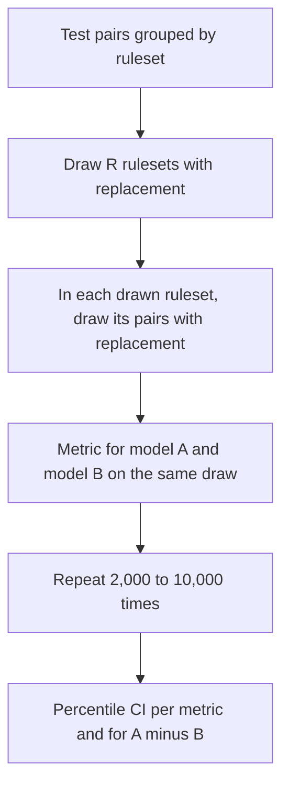

The same draws serve every model, which makes the comparison paired. Fairlearn `MetricFrame` produces the per-group point estimates, and this bootstrap produces their intervals. A unit test compares the result with `scipy.stats.bootstrap` when each ruleset has one pair.

---

## 8. Risks to keep visible

| Risk | Where | Mitigation |
|---|---|---|
| Not enough power for the ≥ 5pp claim | 4.4 | Power simulation in week 2; out-of-fold estimate |
| Split leakage | 3.2, 4.1 | Invariant suite as a blocking DVC stage |
| DSU chaining | 4.3 | Diameter check, manual review |
| Context leaks the source | 4.5 | Context dropout, with/without slice |
| vLLM and training on the same card | 3.1 | Resolved by D27 |
| Ambiguous Stage-2 semantics | 5.1 | Resolved by D29 |
| Silver labels share bias with the rule-prompted baseline | Proposal 7.1 | That comparison is decided on gold |
| Single annotator | Proposal 6.3 | Blind labelling, intra-annotator κ |
| Blackwell toolchain | 3.1 | Pin and verify the image tags first |

## 9. Next step

The architecture is settled. The next document breaks the work into workstreams along S1–S7, with dependencies, the week-2 minimal pipeline as the first milestone, and the Docker setup on the GPU box as the first item.
